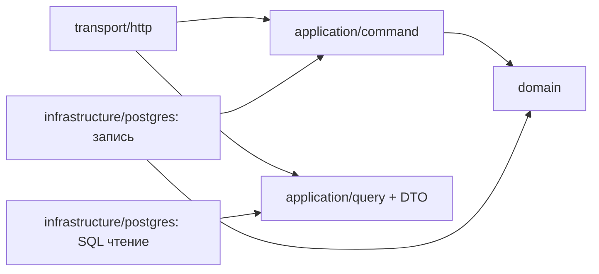

# Организация Go API

Бэкенд — одно приложение. `cmd/api` собирает зависимости, `platform` предоставляет техническую инфраструктуру. Продуктовые модули `profile`, `analysis`, `catalog` и `tracking` добавляются вместе с реальными сценариями; сейчас их пакетов и таблиц нет.

## Структура модуля

Для нового продуктового модуля использовать следующий шаблон. Это соглашение о размещении кода, а не перечень обязательных пустых папок.

| Путь внутри модуля          | Ответственность                                                                          |
| --------------------------- | ---------------------------------------------------------------------------------------- |
| `domain`                    | Сущности, value objects и правила изменения состояния без зависимостей от инфраструктуры |
| `application/command`       | Команды, сценарии изменения состояния, потребляемые контракты и границы транзакций       |
| `application/query`         | Запросы чтения, DTO результата и потребляемые контракты чтения                           |
| `infrastructure/postgres`   | Реализации контрактов записи и чтения через sqlx и параметризованный SQL                 |
| `infrastructure/<provider>` | Адаптер внешнего API, когда появится соответствующая интеграция                          |
| `transport/http`            | HTTP-входы и ответы, преобразование ошибок, вызов сценария                               |

Имена файлов обозначают сценарий, например `update_profile.go`, а не общий контейнер для любых действий. Интерфейс определяет потребитель. Не создавать универсальный Repository, общий service layer, шину команд или DI-контейнер без конкретной потребности.

## Направление зависимостей

Стрелки обозначают зависимости кода. Конкретные реализации передаются в прикладные сценарии из `cmd/api`.

Домен не импортирует Fiber, sqlx, драйвер PostgreSQL, HTTP-клиент или домен другого модуля. Транспорт не выполняет SQL и не хранит бизнес-правила. Инфраструктурные адаптеры реализуют контракты внутреннего слоя; прикладной сценарий не зависит от конкретного драйвера.

## Команды

Команда меняет состояние. Прикладной сценарий проверяет право на действие, загружает нужные данные, применяет доменные правила и сохраняет результат в транзакции модуля, владеющего данными. Входной DTO команды не заменяет доменную модель.

Граница транзакции принадлежит сценарию. Реализация транзакционного контракта находится в PostgreSQL-адаптере; `sqlx.Tx` не передаётся в домен. Конкретную форму контракта выбирать вместе с первым сценарием, которому нужна транзакция, а не добавлять общий Unit of Work заранее.

Модуль изменяет только свои таблицы. Межмодульная координация использует синхронные прикладные контракты и сама по себе не создаёт общую транзакцию. Внешние OCR/ИИ-вызовы не выполняются при удержании блокировок или открытой транзакции БД.

Повторяемые команды с побочными эффектами требуют согласованного контракта идемпотентности. Общие инварианты нескольких экземпляров API обеспечиваются транзакциями, атомарными SQL-операциями и ограничениями PostgreSQL. Mutex внутри процесса эту задачу не решает.

## Запросы

Запрос читает данные и возвращает удобный для ответа DTO. Прикладной query-handler выполняет проверку доступа и входа, затем использует контракт чтения. SQL-адаптер может сразу заполнять DTO через `GetContext` / `SelectContext`; восстанавливать сущность и запускать бизнес-методы ради чтения не требуется.

Допустимы JOIN между таблицами модулей общей БД. Query не меняет данные и не вызывает команду ради подготовки ответа. Параметры SQL связываются отдельно; динамические идентификаторы выбираются из разрешённого списка. Проверка владельца должна учитываться самим запросом или согласованной проверкой доступа — наличие read-модели не означает публичность данных.

Обе стороны используют одну PostgreSQL. Отдельное хранилище чтения, брокер и event sourcing для такого разделения не требуются.

## Контексты и ошибки

`context.Context` передаётся первым аргументом в сценарий и далее в SQL/внешние адаптеры. Контекст не хранится внутри долгоживущего сервиса и не заменяется на `context.Background()` для продолжения пользовательской операции после её отмены.

Текущий HTTP-слой задаёт deadline через `UserContext`; Fiber v2/fasthttp не гарантирует отмену по отключению клиента. Каждый адаптер обязан использовать методы с `Context` и ограничивать ожидание. Запуск goroutine должен иметь конкретную задачу, владельца, предел параллелизма и способ завершения.

Ошибки домена и сценария описывают причину, не HTTP-статус. Транспорт преобразует их в контрактный JSON. SQL, токены, содержимое профиля, состав и фото не выводятся в технические логи и публичные ошибки.

Общие продуктовые правила и требования к конкурентности — в [архитектуре](../../../docs/architecture.md) и [AGENTS.md API](../AGENTS.md).
