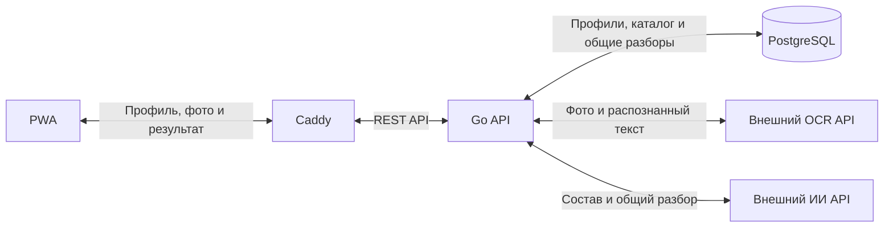
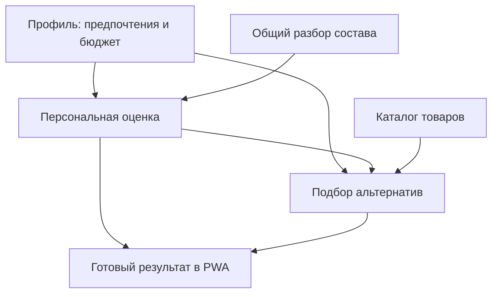

# Архитектура ПоСоставу

## Статус документа

Технический каркас PWA реализован в `apps/pwa`: запуск, тема, маршрутизация, manifest, статический кэш, локальные проверки и контейнерная сборка. В `apps/api` реализован технический каркас Go API: конфигурация, PostgreSQL, health endpoints, управляемая остановка, отдельные миграции и локальные проверки. `infra/compose.yaml` запускает PostgreSQL, API и общий шлюз Caddy со статикой PWA. `/api` направляется в Go на одном локальном origin. [CI](ci.md) проверяет оба приложения и Docker-сборки.

Продуктовые сценарии и их подключение к интерфейсу пока не реализованы. [CD](cd.md), production Compose и серверный обработчик подготовлены в репозитории, публикация и выкладка выключены. Внешний HTTPS на VPS ещё не проверен. Остальные разделы описывают планируемую структуру и требования к ней.

Продуктовые цели, границы, критерии успеха, сроки и бюджет определяет [устав ПоСоставу](charter.md): редакция 1.3 от 04.11.2026 с уточнением репозитория от 07.11.2026. Архитектура реализует эти требования с внешним OCR API и автоматической обработкой фото без промежуточного редактирования текста.

Постоянные архитектурные правила хранятся здесь. Правила работы с кодом конкретного приложения — в его `AGENTS.md`. Решения отдельного изменения и причины их выбора описываются в `openspec/changes/<имя>/design.md`.

## 1. Цели и ограничения

- Первая версия работает с шампунями
- Приоритет MVP — закончить основной пользовательский сценарий с минимальным набором зависимостей
- Основной сценарий пользователя: свободный текст предпочтений и выбор бюджета → отправка фото → готовый разбор состава, персональная оценка, сравнение шампуней и альтернативы
- Сервер выполняет обработку целиком: передаёт фото внешнему OCR API, проверяет полученный текст и автоматически использует его для ИИ-разбора. Промежуточное исправление и подтверждение текста пользователем не требуются
- Общий разбор сохраняется в БД и используется повторно. Персональная оценка отделена от общего разбора и пересчитывается при изменении профиля
- Альтернативы подбираются из ограниченного каталога по соответствию профилю, бюджету и доступным сведениям о наличии. Сравнение включает состав, персональную оценку и причины соответствия. Ссылки на магазины могут быть обычными. Партнёрская интеграция не обязательна, размер комиссии не определяет порядок рекомендаций
- Загруженный состав не оценивается по экологичности и этичности. Эти критерии допустимы только при подборе альтернатив и наличии подтверждённых сведений о товаре или бренде
- Основной сценарий доступен в пределах бесплатного месячного лимита. Исходный настраиваемый ориентир — 10 сканирований. После его исчерпания используются сканирования демонстрационного пакета. В MVP нет реальных оплат, эквайринга и подписки. Демоактивация явно обозначается и не требует платёжных данных
- Основная гипотеза монетизации после MVP — платные пакеты сканирований, комиссии магазинов — дополнительная гипотеза. Интерес к демопакетам не считается подтверждением платёжного спроса. История сканирований и диалог с ИИ остаются за границами MVP

Требования и пограничные случаи уточняются в OpenSpec перед реализацией каждого изменения.

## 2. Общая схема

Бэкенд состоит из модулей и развёртывается одним приложением.

PWA отправляет фото в REST API приложения и показывает состояние обработки и готовый результат. Бэкенд управляет всей последовательностью OCR → проверка распознанного текста → ИИ-разбор → персональная оценка и альтернативы. Доступ к БД и вызовы внешних сервисов выполняются на сервере. Клиент не управляет переходами между OCR и ИИ.

Локальный OCR на Tesseract.js исключён из архитектуры. OCR-движок не запускается ни в браузере, ни в нашем Go-приложении: бэкенд интегрируется с внешним OCR API. Конкретный OCR-провайдер пока не выбран. Собственный API приложения сохраняется как граница между PWA и внешними сервисами.

API масштабируется запуском нескольких экземпляров приложения с общей PostgreSQL за Caddy. Модули при этом остаются внутри одного приложения. Данные, от которых зависит корректность операции, не привязываются к памяти или локальному диску одного экземпляра. Локальный кэш допускается как необязательное ускорение.

### Причины отказа от локального OCR

По текущей оценке команды, качество распознавания у рассматривавшегося локального OCR — около 50%. Ошибки в названиях ингредиентов могут дать неполный или неверный разбор. Пользователю придётся повторно фотографировать этикетку вместо того, чтобы сразу получить полезный результат.

Более тяжёлые модели требуют больше процессорных ресурсов, памяти и энергии, дольше загружаются и обрабатывают фото. Скорость и стабильность зависят от телефона, особенно на слабых устройствах. Поэтому модели на устройстве пользователя не запускаются. PWA отвечает за отправку фото и показ результата.

Распознавание выполняется через внешний OCR API, который вызывает наш бэкенд. Основная вычислительная нагрузка переносится с устройства пользователя на инфраструктуру провайдера. До интеграции нужно проверить качество выбранного сервиса на этикетках шампуней.

## 3. Технологический стек

### PWA

| Компонент | Решение |
| --- | --- |
| Основа | React + TypeScript + Vite |
| UI | Mantine |
| Навигация | React Router |
| Запросы и серверное состояние | TanStack Query |
| PWA и кэширование | `vite-plugin-pwa` |
| Архитектура | Feature-Sliced Design (FSD) |
| Линтинг | ESLint с typescript-eslint и правилами React Hooks |
| Форматирование | Prettier. Совместимость с ESLint через eslint-config-prettier |
| Проверка типов | TypeScript (`tsc --noEmit`), отдельно от линтинга |
| Тестирование бизнес-логики | Vitest, среда Node.js |
| Работа с составом | Отправка фото в API приложения, показ состояния обработки и готового результата |

### Бэкенд

Распознавание выполняется через внешний OCR API. Провайдер выбирается до реализации интеграции. Ключи OCR и ИИ хранятся только на серверной стороне.

| Компонент | Решение |
| --- | --- |
| Язык | Go 1.27.3 |
| HTTP-фреймворк | Fiber v2 |
| База данных | PostgreSQL |
| Доступ к БД | sqlx + обычные SQL-запросы, драйвер pgx |
| Миграции | golang-migrate |
| Конфигурация | go-envconfig |
| Логи | Стандартный `log/slog` |
| API | REST + OpenAPI |
| Архитектура | Одно приложение с модулями. Clean Architecture с элементами DDD |
| Команды | Доменная модель и бизнес-правила |
| Запросы | Отдельные обработчики чтения и DTO |
| Форматирование | Стандартный `gofmt` |
| Линтинг | golangci-lint v2: govet, staticcheck, errcheck, ineffassign, unused |
| Тестирование бизнес-логики | Стандартный пакет `testing` |
| Squirrel | В MVP не используется |

PostgreSQL — согласованная СУБД проекта. Библиотека sqlx и обычный SQL дают явный контроль над запросами. В MVP отдельный конструктор запросов не подключается.

### Организация и инфраструктура

| Компонент | Решение |
| --- | --- |
| Репозиторий | Монорепозиторий |
| OpenSpec | Один экземпляр в корне |
| Клиентские зависимости | npm. Отдельный пакет в `apps/pwa` |
| Зависимости бэкенда | Go modules |
| Запуск | Docker Compose |
| HTTPS и раздача PWA | Внешний Traefik завершает HTTPS, Caddy отдаёт PWA по HTTP и проксирует API своего цвета |
| CI | GitHub Actions |
| Общие команды | Go Task, `Taskfile.yml` |

## 4. Устройство PWA

Интерфейс проектируется mobile-first: Mantine AppShell, компактная шапка, рабочая область и нижняя навигация «Анализ» / «Профиль». На широком экране рабочая область ограничена по ширине. Учитываются safe area, динамическая высота экрана и размер зон нажатия. Текущие экраны — заготовки. Загрузка фото и редактирование профиля требуют отдельной реализации.

| Путь | Ответственность |
| --- | --- |
| `apps/pwa/src/app/` | Инициализация, провайдеры и роутер |
| `apps/pwa/src/pages/` | Страницы и сборка пользовательских сценариев |
| `apps/pwa/src/widgets/` | Составные блоки интерфейса, когда они понадобятся |
| `apps/pwa/src/features/` | Действия пользователя: изменение профиля, отправка фото на анализ, сравнение и выбор альтернативы, демоактивация пакета |
| `apps/pwa/src/entities/` | Модели и представления продуктовых сущностей, когда они понадобятся |
| `apps/pwa/src/shared/` | Общий UI, API-клиент и утилиты без логики конкретного сценария |
| `apps/pwa/public/` | Статические файлы PWA |

Архитектуру PWA проверяет Steiger с рекомендуемыми правилами `@feature-sliced/steiger-plugin`. Команда `npm run lint:fsd` входит в `npm run check`.

Точка входа React — `src/main.tsx`, публичный вход слоя приложения — `app/index.ts`. Внутри `app` код разделён по назначению: `init` содержит провайдеры и границу ошибок, `router` — маршруты, `layouts` — мобильную оболочку с CSS Module, `styles` — глобальные стили и тему Mantine, `pwa` — состояние сети и управляемое обновление. Компонент `App` объединяет инициализацию и роутер. Тема приложения не хранится в `shared/ui`, пока общего набора UI-компонентов нет.

При production-сборке в HTML добавляется CSP: скрипты, шрифты и worker загружаются с текущего origin. Соединения разрешены с текущим origin и origin проверенного API-адреса. Inline-стили нужны Mantine, inline-скрипты и `eval` запрещены. HTTP-заголовки Caddy запрещают встраивание приложения в чужие страницы. Политика ресурсов сохраняется вместе с офлайн-оболочкой. Внешний HTTPS-шлюз остаётся отдельной задачей.

Для совместимости с CSP абсолютный production URL API должен содержать доменное имя, а не IP-адрес. По умолчанию используется относительный `/api`. Шрифты поставляются отдельными файлами, без встраивания в CSS как `data:`.

Правила FSD:

- Направление зависимостей: `app → pages → widgets → features → entities → shared`. Слой может обращаться к любому нижележащему слою
- Срезы внутри `pages`, `widgets`, `features` и `entities` не импортируют внутренности соседних срезов. Взаимодействие собирается на верхнем слое или через нижележащие сущности и общие контракты
- Внешние потребители используют публичный API среза. Внутренние детали среза не становятся общими по умолчанию
- `shared` не зависит от продуктовых слоёв и не служит местом для любой повторяющейся бизнес-логики
- `widgets` и `entities` создаются по необходимости. Пустые слои ради структуры не нужны
- Серверное состояние ведётся через TanStack Query. На клиенте остаются состояние интерфейса, выбор и предпросмотр фото, отображение хода обработки и результата. Редактор распознанного текста и отдельный шаг его подтверждения не предусматриваются
- Профиль редактируется как свободный текст предпочтений и выбор бюджета из списка. PWA показывает бесплатный месячный лимит, остаток демопакета и явную маркировку демонстрационной активации. Остатки и результат списания получает от API. Клиентский счётчик не является источником истины
- После ошибки анализа интерфейс сохраняет возможность безопасного повтора и не показывает успешное списание. Повторная отправка одного действия использует тот же ключ идемпотентности по контракту API. Открытие готового результата не создаёт новый анализ или списание
- Анализ фото требует сети. При ошибке загрузки или обработки пользователь получает понятное сообщение, а выбранное фото и настройки профиля сохраняются в текущем сценарии. Локальный OCR как резервный путь не предусматривается
- Техническая оболочка PWA кэширует только статические HTML, JS, CSS, локальные шрифты и иконки. Офлайн-навигация разрешена для оболочек `/` и `/profile`. API, фото и персональные данные не кэшируются, фоновой отправки нет. Новая версия применяется по кнопке пользователя. В dev service worker отключён. Расширение этой политики фиксируется отдельным изменением

## 5. Устройство бэкенда

### Модули

| Модуль | Ответственность |
| --- | --- |
| `internal/profile/` | Создание, чтение, изменение и удаление профиля пользователя: предпочтения и бюджет |
| `internal/analysis/` | Серверная обработка фото: внешний OCR API, проверка текста, ИИ-разбор состава, общий кэш и персональная оценка |
| `internal/catalog/` | Каталог и подбор альтернатив |
| `internal/tracking/` | События сценария, лимитов и демопакетов для аналитики. Переходы в магазины |
| `internal/platform/` | Подключение БД, конфигурация и логирование |

`cmd/api/main.go` — точка сборки приложения: создание зависимостей, подключение модулей и запуск HTTP-сервера. `platform` содержит техническую инфраструктуру. Бизнес-правила остаются в профильных модулях.

Сейчас реализованы только пакеты `platform/config`, `platform/postgres`, `platform/httpserver` и `platform/lifecycle`. Продуктовые модули добавляются вместе с первым сценарием. Для них принят шаблон `domain`, `application/command`, `application/query`, `infrastructure/postgres`, `transport/http`. Структура и направление зависимостей описаны в [README внутреннего кода](../apps/api/internal/README.md). Пустые сущности, универсальный Repository и шина команд ради каркаса не создаются.

### Clean Architecture и DDD

- Домен содержит бизнес-правила и не зависит от Fiber, sqlx, подключения к PostgreSQL и внешних OCR- и ИИ-сервисов
- Прикладные сценарии координируют работу домена и определяют границы транзакций команд
- HTTP-обработчики преобразуют запросы и ответы и вызывают прикладные сценарии. Бизнес-правила не размещаются в HTTP-обработчиках
- Реализации доступа к БД и внешним сервисам находятся на инфраструктурной стороне. Интерфейсы зависимостей определяются там, где они потребляются
- Конкретные интерфейсы и структура пакетов внутри модуля определяются при реализации его сценариев. Абстракции создаются для реальных границ и правил

Владение данными лимитов и демопакетов и границы соответствующего модуля определяются в OpenSpec до реализации счётчика. Аналитические события `tracking` не заменяют серверный учёт остатков и списаний.

### Команды и запросы

| Сторона | Подход |
| --- | --- |
| Команда | Изменяет состояние. Использует прикладной сценарий и доменную модель с бизнес-правилами |
| Запрос | Читает данные. Может выполнять SQL и возвращать DTO без восстановления доменных объектов |

DDD применяется на стороне команд. Запросы используют модель чтения и DTO. Это разделение не требует отдельных баз данных, брокера сообщений или event sourcing.

Query-handler задаёт контракт чтения для адаптера PostgreSQL. PostgreSQL-адаптер выполняет параметризованный SQL через `GetContext` / `SelectContext` и заполняет DTO, не восстанавливая доменные сущности. Транспорт не получает прямой доступ к sqlx. Командный сценарий определяет границу транзакции. Конкретный транзакционный контракт появляется вместе со сценарием, которому он нужен.

Команды и запросы проверяют доступ и входные данные. Команда может принимать DTO, но после его преобразования применяет доменные правила.

Каждый продуктовый модуль владеет своими данными: `profile` — профилями, `analysis` — общими разборами и персональными оценками, `catalog` — товарами и данными подбора, `tracking` — событиями и партнёрскими переходами. Модуль изменяет только принадлежащие ему таблицы.

Модули взаимодействуют синхронно через прикладные контракты с DTO. Домен не импортирует домен другого модуля. На стороне запросов разрешены SQL JOIN между таблицами модулей в общей PostgreSQL с возвратом DTO. Изменять прочитанные таблицы может только команда модуля, который ими владеет.

Граница транзакции команды находится внутри владеющего данными модуля. Сценарий с участием нескольких модулей координируется на прикладном уровне и сам по себе не образует общую транзакцию.

## 6. Данные и обработка состава

- PWA одним действием отправляет фото на анализ. Бэкенд получает текст через внешний OCR API, проверяет его и автоматически продолжает ИИ-разбор, формирует персональную оценку и подбирает альтернативы. В PWA возвращается готовый результат. Распознанный текст не требует отдельного пользовательского действия. Фото в ИИ-сервис не передаётся
- До отправки фото интерфейс сообщает, что распознавание выполняет внешний сервис. Условия передачи и хранения изображений у OCR-провайдера должны быть определены до реализации интеграции. Обещание, что фото остаётся только на устройстве, больше не применяется
- Фото передаётся защищённо, используется для распознавания и не включается в общий кэш ИИ-разбора. Оно удаляется после обработки или истечения ограниченного срока. Механизм удаления, точный срок и условия у OCR-провайдера определяются до интеграции. Постоянное хранение изображений не предусматривается. Фото и составы не попадают в технические логи
- Бэкенд проверяет допустимые форматы и размеры изображений, ограничивает время и параллелизм OCR-вызовов. Успешный OCR с пригодным для разбора текстом автоматически продолжает серверный сценарий. При ошибке OCR или непригодном результате ИИ не вызывается. Возвращается контролируемая ошибка с возможностью безопасного повтора по правилам идемпотентности. Критерии пригодности результата определяются при реализации интеграции
- Общий разбор состава и персональная оценка имеют разные назначения и жизненные циклы. Изменение профиля не должно требовать повторного ИИ-разбора, если подходящий общий разбор уже доступен
- Ключ повторного использования общего разбора, нормализация состава, версии анализа и срок актуальности определяются в изменении, реализующем анализ
- Схема PostgreSQL изменяется миграциями `golang-migrate`: файлы `.up.sql` и `.down.sql` в `apps/api/migrations/`
- Миграции выполняет отдельный `cmd/migrate` с ролью `posostavu_migrator`. HTTP-процесс использует `posostavu_app` и не меняет схему при запуске. Последовательные пары имеют шестизначный номер. `down` откатывает один шаг. `down-all` и `force` требуют явного подтверждающего флага. `force` меняет только метаданные версии после ручной проверки фактической схемы. Новая миграция явно выдаёт рабочей роли необходимые права на свои таблицы и последовательности. Общего доступа ко всем будущим таблицам нет
- Секреты не хранятся в репозитории. В примере конфигурации указываются имена переменных и безопасные образцы значений

### Профиль пользователя

Профиль хранится на сервере и используется для оценки состава и подбора альтернатив:

| Данные | Назначение |
| --- | --- |
| Предпочтения | Свободный текст личных критериев оценки состава и подбора товаров |
| Бюджет | Выбор из списка ценовых ограничений при подборе альтернатив |
| Связь с владельцем | Проверка доступа к профилю и использование данных нужного пользователя |

Модуль `profile` хранит профиль в PostgreSQL и предоставляет операции чтения, сохранения изменений и удаления через API. PWA показывает и редактирует профиль. Локальный черновик и кэш интерфейса не заменяют сохранённые серверные данные. Сервер определяет владельца по идентифицированному пользователю и проверяет доступ при каждом обращении. Способ идентификации выбирается при реализации этого сценария.

При запуске анализа сервер использует сохранённые значения профиля для персональной оценки и подбора альтернатив. Модули `analysis` и `catalog` получают данные профиля через прикладные контракты или разрешённую модель чтения. Они не изменяют таблицы `profile`.

Общий ИИ-разбор описывает состав независимо от пользователя. Предпочтения, бюджет и идентификатор владельца не включаются в общий разбор и его общий кэш. Персональная оценка и подбор альтернатив выполняются на сервере по общему разбору и профилю. Изменение профиля пересчитывает персональную часть. Повторные OCR и ИИ-разбор того же состава не нужны, если подходящий общий разбор уже доступен.

Предпочтения задаются свободным текстом, бюджет выбирается из списка. Ограничения длины текста, конкретные значения бюджета, обязательность полей и поведение при незаполненном профиле определяются в соответствующем OpenSpec change до реализации. Эти детали не меняют выбранное хранение в PostgreSQL и разделение общего разбора и персональной оценки.

### Лимиты и демонстрационные пакеты

- Бесплатный месячный лимит настраивается на сервере. 10 сканирований — исходный ориентир пилота. Сначала используется бесплатный остаток, затем остаток демопакета. Реальные платежи, подписка и платёжные данные в MVP отсутствуют
- Остатки, демоактивации и подтверждённые списания хранятся на сервере в PostgreSQL и привязаны к владельцу. Клиент не задаёт доверенный остаток или факт успешного анализа
- Ошибки OCR, ИИ и анализа не расходуют доступные сканирования. Повтор одной логической операции, параллельные запросы и повторное открытие готового результата не создают двойных или случайных списаний
- Проверка доступности, возможное резервирование, фиксация успешного результата и списание проектируются как согласованный серверный сценарий с защитой между экземплярами API. Сбой между этапами не должен приводить к потерянному остатку или повторному списанию. Конкретная модель согласования определяется до реализации
- Единица сканирования, момент обновления месяца и часовой пояс, размер и срок действия демопакета, правила повторной активации, пересчёта по изменённому профилю и учёта кэшированного разбора ещё не определены. Эти правила фиксируются в OpenSpec до разработки счётчика. Расчётный пакет 20 сканирований за 199 ₽ из устава не является утверждённым тарифом или размером демопакета
- Проверяются значимые сценарии: успешный анализ, ошибка, повтор и параллельный запрос, исчерпание бесплатного остатка, переход к пакету и смена месяца. Для инвариантов PostgreSQL используются интеграционные тесты по правилам этого документа

### Аналитика и проверка гипотез

События, воронка и дашборд отражают завершённые проверки, повторное использование, расход бесплатного лимита, интерес к пакетам, ошибки, долю кэша и стоимость успешного анализа с учётом неуспешных попыток и повторов. Демонстрационные активации учитываются отдельно от покупок. Денежная выручка MVP равна нулю, ARPPU и LTV до реальных оплат не измеряются. Профили, фото и полные составы в события не включаются.

Приёмка следует уставу: работающая версия к концу недели 6, UX-проверка с 10 пользователями и целью 8 успешных самостоятельных сценариев за 2 минуты, пилот с 30 пользователями. План A/B-теста включает гипотезу, метрики, расчёт выборки и длительности и порядок анализа. Проведение эксперимента не требуется. Сроки и ресурсные ограничения сохраняются в уставе и задачах Linear, а не считаются подтверждением готовности кода.

### Конкурентность, блокировки и тупики

- Гонки памяти Go и логические гонки в PostgreSQL рассматриваются отдельно. Mutex защищает состояние одного процесса. Бизнес-инварианты при работе нескольких экземпляров защищаются общей БД
- Конкурентное изменение данных выполняется через атомарный SQL, условное обновление с проверкой результата или транзакцию с блокировкой строк — в зависимости от бизнес-инварианта. Уникальность обеспечивается ограничением БД. Проверка существования перед вставкой сама по себе не защищает от параллельной вставки
- Для предупреждения тупиков (deadlocks) блокировки захватываются в согласованном порядке, критические секции и транзакции остаются короткими. Внешние HTTP/ИИ-вызовы и длительная обработка выполняются вне удерживаемых mutex и транзакций БД
- Deadlock и serialization failure завершают неуспешную транзакцию откатом. Допустим ограниченный повтор всей безопасной транзакции с повторным чтением данных. Повтор отдельного SQL в уже прерванной транзакции не применяется. Повтор учитывает deadline и не дублирует внешние эффекты
- Идемпотентность команд и дедупликация общих операций должны работать между экземплярами и после перезапуска. Память процесса и локальные блокировки не являются единственной защитой от дублей
- Ожидание БД и внешних сервисов ограничено временем. Количество goroutine и параллельных внешних вызовов ограничено. Отмена и завершение операции освобождают её ресурсы

### Горизонтальное масштабирование и отказы

| Ситуация | Ожидаемое поведение |
| --- | --- |
| Внешний API недоступен или отвечает слишком долго | Зависимый сценарий завершается контролируемой ошибкой. Независимые сценарии продолжают работать |
| Общая PostgreSQL недоступна | Операции, требующие БД, завершаются контролируемой ошибкой. Неподтверждённая запись не выдаётся за успешную |
| Один экземпляр API остановлен | Шлюз направляет новые запросы на готовые экземпляры. Прерванная операция обрабатывается как сбой, её повтор требует идемпотентности |
| Все экземпляры API недоступны | Шлюз возвращает ошибку доступности, PWA обрабатывает также сетевую ошибку или ответ без JSON и сохраняет ввод в текущем сценарии |
| Два экземпляра одновременно изменяют одни данные | Сохраняются бизнес-инварианты. Конфликт обрабатывается явно, без незаметной потери обновления |

- Отказ зависимости не должен приводить к завершению процесса API, бесконечной загрузке или исчерпанию ресурсов независимых сценариев. Для внешних вызовов используются deadlines, ограничение параллелизма и ограниченные повторы безопасных операций
- Повтор запроса не означает гарантированного отсутствия первого результата. Команды и платные внешние вызовы не повторяются вслепую при неизвестном исходе
- Допустимый кэшированный результат используется только по правилам соответствующего продуктового сценария. Ошибка не маскируется вымышленным результатом анализа
- Пулы соединений PostgreSQL и лимиты внешних сервисов рассчитываются с учётом числа экземпляров API. Новое хранилище или сервис координации не добавляется без согласования. Базовая общая координация использует PostgreSQL
- Миграции выполняются одним шагом развёртывания. Каждый экземпляр API не запускает их самостоятельно
- Проверка жизнеспособности процесса не зависит от внешних OCR- и ИИ-сервисов. Готовность принимать трафик учитывает необходимые ресурсы приложения. Сбой необязательной для других сценариев зависимости не исключает из балансировки весь API
- При штатной остановке экземпляр перестаёт принимать новые запросы и ограниченно ждёт завершения текущих операций. Возможность аварийной остановки всё равно учитывается в транзакциях и идемпотентности

### Ключи идемпотентности

Для команд с побочными эффектами, которые могут повторяться после сетевой ошибки или тайм-аута, используется `Idempotency-Key`. PWA создаёт ключ один раз на логическую операцию и сохраняет его для повторов. Новое действие или изменение значимых входных данных требует нового ключа. Чистые чтения ключа не требуют.

| Ситуация | Поведение API |
| --- | --- |
| Ключ новый | Атомарно регистрирует операцию в PostgreSQL и допускает её выполнение |
| Ключ и данные совпадают, операция завершена | Возвращает сохранённый результат без повторного бизнес-эффекта |
| Ключ уже связан с другими значимыми данными | Возвращает `409` с машинным кодом конфликта ключа |
| Операция с ключом ещё выполняется | Возвращает `409` с машинным кодом состояния выполнения. Повторное выполнение не запускается |
| Исход внешней операции неизвестен | Не считает её успешной или безопасно повторяемой. Выясняет исход по контракту внешнего сервиса |

- Ключ уникален в пределах владельца запроса и операции. Авторизация выполняется при каждом обращении. Ключ не даёт права получить чужой результат
- PostgreSQL хранит ключ, отпечаток значимых входных данных, состояние и завершённый результат. Уникальное ограничение и атомарная регистрация обеспечивают общую защиту для всех экземпляров API
- Для локального изменения данных фиксация бизнес-результата и завершение записи идемпотентности происходят в одной транзакции владеющего данными модуля. При ошибке этой транзакции частичный бизнес-результат не сохраняется
- Внешний ИИ/HTTP-вызов не выполняется внутри удерживаемой транзакции. Резервирование операции в БД, поддержка идемпотентности провайдером и выяснение исхода после сбоя рассматриваются отдельно. Одна запись ключа в нашей БД не гарантирует однократный внешний эффект
- После неизвестного исхода клиент повторно использует прежний ключ. Автоматическая выдача нового ключа и слепой повтор платного вызова запрещены. Перезапуск API или истечение блокировки не означают отсутствия эффекта
- OpenAPI каждой такой команды определяет обязательность и ограничения ключа, окно хранения и машинные коды ошибок. Гарантия повторного получения результата ограничена окном хранения. Старые ключи не используются для новых операций
- При недоступности хранилища идемпотентности защищённая команда возвращает контролируемую ошибку и не выполняется без защиты. Локальный кэш или mutex не заменяет запись PostgreSQL
- Проверки затрагивают значимые бизнес-сценарии дублей, параллельного выполнения и сбоя, без требования теста на каждый технический элемент

### Безопасность и секреты

| Область | Правило |
| --- | --- |
| Секреты сервисов | Только серверная конфигурация окружения или хранилище секретов. Без значений в Git, образах, логах и API-ответах |
| PWA | Код и конфигурация публичны. Секреты в `VITE_*` и подставляемых при сборке значениях запрещены |
| Браузерное хранение | Серверные секреты, пароли, сессионные идентификаторы и access/refresh-токены не хранятся в доступных JavaScript браузерных хранилищах |
| Авторизация | Проверка конкретной операции и объекта на сервере, доступ закрыт по умолчанию. Владелец определяется сервером |
| SQL | Параметризованные значения. Динамические идентификаторы выбираются из разрешённого списка |
| Передача данных | HTTPS с проверкой сертификатов. Секреты и пользовательские данные не передаются в URL |
| Логи и ошибки | Без фото, токенов, cookies, паролей, полного состава, профиля, SQL и stack trace в публичном ответе |
| Права БД | Рабочая роль с минимальными правами. Миграции выполняются отдельно с необходимыми для них правами |

- PWA обращается к OCR- и ИИ-провайдерам только через API приложения. Их ключи не передаются клиенту. Минификация, обфускация и наличие `.env` не делают значение секретным после включения в клиентскую сборку. Приватные ключи, ключи подписи и пароли PostgreSQL никогда не передаются клиенту
- В `.env.example` находятся только безопасные заглушки. Реальные секреты не копируются в документы и сообщения при диагностике. При обнаружении утечки требуется отзыв или ротация. Простое удаление значения из текущего файла не устраняет утечку из прежних копий
- Валидация клиента служит удобству пользователя. Бэкенд повторно проверяет входные данные, принадлежность объекта и разрешение на действие. Эти проверки применяются и к результатам по ключам идемпотентности
- Cookie-аутентификация требует HttpOnly/Secure cookies, подходящей SameSite-политики и защиты от CSRF. CORS ограничивает разрешённые origin и не заменяет авторизацию. Способ идентификации пользователя выбирается в соответствующем продуктовом изменении с соблюдением этих ограничений
- Ответы ИИ, внешние API и пользовательский ввод считаются недоверенными. Клиент выводит текст безопасно. Бэкенд валидирует внешние данные, не выполняет их как код или SQL и ограничивает назначения исходящих HTTP-запросов. Произвольные адреса, включая адреса из ответов ИИ, не являются разрешёнными по умолчанию
- Размер запросов, время ожидания, параллелизм и расход внешних сервисов ограничиваются. Общие квоты учитывают несколько экземпляров API. Локальное ограничение процесса не гарантирует общей защиты
- Service worker не сохраняет секреты и ответы авторизации. Приватные API-данные не кэшируются без явно определённой безопасной политики. При завершении сессии клиент очищает связанные с ней данные и кэш запросов
- В тестах проверяются значимые правила доступа, изоляция пользовательских данных и недопустимые бизнес-действия. Формальные тесты каждого технического защитного элемента и целевой процент покрытия не требуются

## 7. HTTP API

PWA и бэкенд взаимодействуют через REST. OpenAPI используется для описания методов, входных данных, ответов и ошибок в `contracts/openapi.yaml`.

Контракт предоставляет единый пользовательский сценарий анализа по фото: клиент отправляет изображение и получает состояние обработки, готовый результат или ошибку. Сервер сам выполняет OCR и последующий ИИ-разбор. Отдельные клиентские запросы для подтверждения текста и запуска ИИ после OCR не требуются. Формат загрузки, ограничения изображений, состояния, ошибки и правила повторов определяются при реализации. Сырой ответ OCR-провайдера не становится публичным контрактом PWA.

Этот YAML-файл является документацией контракта между клиентом и сервером. Для него не нужен отдельный сервис. Сейчас в нём описаны `GET /livez`, `GET /readyz` и общий JSON-формат ошибок технического каркаса. `/livez` не зависит от БД, `/readyz` ограниченно проверяет PostgreSQL и возвращает 503 при её недоступности. Продуктовая схема этим не проверяется. Неизвестный маршрут возвращает 404. Сервер создаёт request ID, не доверяя одноимённому входящему заголовку. В MVP контракт поддерживается вручную и обновляется вместе с реализацией. Автоматическая генерация клиентов и сервера не используется.

Продуктовые сценарии хранятся в OpenSpec. Точная структура HTTP-сообщений — в OpenAPI. Ошибки бэкенда имеют единый описанный в контракте JSON-формат с машинным кодом, понятным сообщением и request ID. Для недоступности зависимости и тайм-аута возвращается соответствующий неуспешный HTTP-статус, а не `200`. Клиент не получает внутренние SQL-ошибки, stack trace или секреты. В логах сохраняется причина ошибки и request ID. Идентификация пользователя и правила доступа определяются в соответствующих продуктовых изменениях.

Ошибка работающего бэкенда и отсутствие самого бэкенда различаются: в первом случае формируется контрактный ответ, во втором ответ формирует шлюз или запрос завершается сетевой ошибкой. PWA обрабатывает оба случая, завершает загрузку и сохраняет пользовательский ввод в текущем сценарии.

### Версии API и совместимость с PWA

Установленная PWA и открытая вкладка могут работать на старой сборке после обновления сервера. Предложение обновить service worker не заменяет обратную совместимость. Правила ниже применяются с первого опубликованного продуктового метода, включая выпуски `0.x.y`.

- Продуктовые методы используют основную версию в URL: `/api/v1/...`, при несовместимом изменении — `/api/v2/...`. Шлюз удаляет только `/api`, поэтому Go регистрирует `/v1/...` и `/v2/...`. Базовый адрес `VITE_API_BASE_URL` остаётся `/api`, версию явно выбирает клиент
- Служебные `GET /livez` и `GET /readyz` остаются без версии. Через шлюз это `/api/livez` и `/api/readyz`. Сейчас реализованы только эти методы. Продуктовые `/v1` и обработка неподдерживаемой версии появятся вместе с соответствующими сценариями
- Основная версия HTTP API, версия выпуска приложения и `info.version` OpenAPI имеют разное назначение. Новый релиз приложения не требует нового URL API. Поле `openapi` задаёт версию формата спецификации, `info.version` — редакцию документа контракта
- Внутри основной версии API старые запросы сохраняют прежний результат и смысл. Нельзя удалять или переименовывать используемые поля и методы, менять типы, обязательность, форматы, значения по умолчанию или семантику операций с нарушением старого контракта. Это относится и к статусам HTTP, машинным кодам ошибок и правилам доступа
- Новые методы, необязательные параметры запроса и дополнительные поля ответа допустимы, если прежние клиенты продолжают работать. Отсутствие нового параметра сохраняет прежнее поведение. Новое значение enum в ответе не считается совместимым автоматически: проверяется поведение выпущенных клиентов
- PWA допускает дополнительные поля ответа, но проверяет обязательные данные и их типы. Расширяемые значения и ошибки имеют безопасную обработку неизвестного варианта. Если старый контракт запрещает дополнительные поля, его нельзя расширять без проверки потребителей
- При несовместимом изменении новый API обслуживается параллельно с прежним в одном Go-приложении. Версионные HTTP-адаптеры преобразуют DTO и вызывают общие прикладные сценарии. Домен и БД не копируются ради номера версии
- PWA не переключает основную версию API по ошибке и не повторяет изменяющую состояние операцию через другой маршрут. Для одной логической операции сохраняется защита от дублей между версиями API и экземплярами сервера

Поддержка опубликованной основной версии не прекращается автоматически после следующего релиза. Её вывод оформляется отдельным изменением: дата прекращения поддержки, затронутые сборки PWA, способ уведомления, контракт ошибки и проверенный путь обновления. Пока этот порядок не принят и не выполнен, прежняя версия остаётся доступной. Отсутствие недавних запросов не доказывает отсутствие старых PWA: пользователь может вернуться после длительного офлайна.

До прекращения поддержки клиент должен уметь показать необходимость обновления без бесконечных повторов и потери текущего ввода. Выпущенные ранее клиенты с таким ответом проверяются отдельно. Само уведомление не гарантирует, что пользователь обновится. Исправления уязвимостей обязательны и для поддерживаемых старых версий, небезопасное поведение ради совместимости не сохраняется.

В описании выпуска фиксируется соответствие сборок PWA поддерживаемым версиям API. При изменении контракта проверяются прежние запросы и значимые сценарии выпущенных клиентов с новым сервером. Проверки используют сохранённые примеры опубликованного контракта, а не только DTO из нового кода. Для отката отдельно проверяется новая PWA с прежним сервером. Одного успешного прогона новой PWA с новым API недостаточно.

Хешированные JS, CSS и другие файлы поддерживаемых сборок PWA должны оставаться доступны после выкладки и отката, включая отложенно загружаемые части приложения. Нельзя полагаться только на кэш service worker. Способ хранения старых файлов и проверка их загрузки входят в реализацию CD. Срок удаления связывается с прекращением поддержки сборки PWA.

Порядок совместимых миграций и переключения между выпусками описан в [регламенте релизов](configuration-and-releases.md#5-blue-green-развёртывание).

## 8. Целевая структура репозитория

| Путь | Содержимое |
| --- | --- |
| `apps/pwa/` | PWA и локальные правила в `AGENTS.md` |
| `apps/pwa/eslint.config.mjs` | Flat-конфигурация ESLint для TypeScript и React |
| `apps/api/` | Go-приложение и локальные правила в `AGENTS.md` |
| `apps/api/.golangci.yml` | Конфигурация golangci-lint v2 |
| `apps/api/cmd/api/main.go` | Точка входа API |
| `apps/api/cmd/migrate/main.go` | Отдельная команда миграций |
| `apps/api/internal/` | Продуктовые модули и техническая инфраструктура |
| `apps/api/migrations/` | Миграции PostgreSQL |
| `apps/api/go.mod`, `apps/api/go.sum` | Зависимости Go |
| `apps/api/tools/go.mod`, `apps/api/tools/go.sum` | Зафиксированные инструменты Go отдельно от runtime |
| `apps/api/Dockerfile` | Сборка контейнера API |
| `contracts/openapi.yaml` | Контракт реализованных служебных HTTP-методов |
| `openspec/config.yaml` | Контекст и правила подготовки артефактов OpenSpec |
| `openspec/specs/` | Принятое поведение продукта |
| `openspec/changes/` | Предлагаемые изменения и архив |
| `docs/architecture.md` | Постоянные архитектурные решения |
| `docs/labs/` | Материалы лабораторных |
| `infra/compose.yaml` | Локальные PostgreSQL, API, общий шлюз со статикой PWA и одноразовые миграции |
| `infra/Caddyfile` | Общий локальный HTTP-шлюз: PWA и маршрутизация `/api` в Go |
| `infra/.env.example` | Пример конфигурации без секретов |
| `.github/workflows/ci.yml` | Проверки CI |
| `AGENTS.md` | Общие правила работы с репозиторием |
| `Taskfile.yml`, `apps/api/Taskfile.yml` | Общие и локальные команды запуска, проверок и миграций |
| `apps/pwa/package.json`, `apps/pwa/package-lock.json` | Настройки npm и клиентские зависимости |
| `.prettierrc.json`, `.prettierignore` | Общие настройки Prettier и исключения |
| `README.md` | Назначение проекта и инструкция запуска |

## 9. Запуск и проверки

- `task up` проверяет локальную конфигурацию, запускает PostgreSQL, выполняет миграции отдельным контейнером, поднимает API и шлюз со статикой PWA и проверяет готовность через общий адрес. Ошибка шага останавливает команду. Порты опубликованы на loopback. Рабочая и миграционная роли разделены. `down` сохраняет volume БД. Конфигурация предназначена для разработки, не для публикации в интернете
- Единственный Caddy использует `infra/Caddyfile` и собирается вместе со статикой через `apps/pwa/Dockerfile`. Он отдаёт PWA и направляет `/api` и `/api/*` в отдельный Go-сервис с удалением префикса `/api`: `/api/readyz` становится `/readyz`. API-ошибки не подменяются HTML и не кэшируются. `/healthz` проверяет сам шлюз, `/api/readyz` — доступность БД через API. При отказе API статическая оболочка остаётся доступной. Локальный шлюз работает по HTTP. Внешний HTTPS и CD настраиваются отдельно. Caddy не встраивается в Go-приложение
- Конфигурация Go-приложения загружается через go-envconfig. Локальный env-файл читается только при явном `-env-file`, переменные процесса имеют приоритет. API и миграции используют отдельные примеры конфигурации и разные роли PostgreSQL. Для логирования используется `log/slog`
- Listener запускается в управляемой goroutine. Результат передаётся каналом. Сигналы через `signal.NotifyContext` запускают ограниченное ожидание запросов, затем оставшиеся операции отменяются. Контексты SQL имеют deadline. Fiber v2/fasthttp сам не отменяет прикладной контекст при отключении клиента. Каждый SQL/HTTP-адаптер должен соблюдать явный `UserContext` и его отмену. Очереди и фоновые продуктовые воркеры появятся только при конкретной необходимости
- Клиентские команды выполняются в `apps/pwa/`, Go-команды — в `apps/api/`, общие команды и OpenSpec — из корня
- Конфигурация GitHub Actions в `.github/workflows/ci.yml` запускает проверки обоих приложений для PR в `develop`/`main` и push в эти ветки. CI использует те же конфигурации и версии инструментов, что и локальный запуск: формат, линтинг, FSD, типы TypeScript, существующие тесты, race detector Go, сборка и аудит зависимостей. PWA, API и миграции дополнительно собираются в Docker. Публикации образов и деплоя нет. События, пороги аудита и итоговый статус `CI status` описаны в [регламенте CI](ci.md). Успешный серверный прогон подтверждается ссылкой на workflow run для проверенного коммита
- Автоматические тесты проверяют бизнес-правила и значимые сценарии по правилам ниже. Наличие нового файла или компонента само по себе не требует теста
- Основной пользовательский сценарий проверяется на связке PWA и API при приёмке изменения: отправка фото приводит к готовому результату без промежуточного действия пользователя. Качество выбранного OCR API проверяется на примерах этикеток шампуней. Проверяются автоматический переход к ИИ после успешного OCR и контролируемая ошибка до вызова ИИ при отказе OCR или непригодном тексте. Платные OCR- и ИИ-вызовы не выполняются в обычных тестах и CI

### Форматирование и статический анализ

| Область | Правило |
| --- | --- |
| PWA | ESLint в flat-формате с typescript-eslint, рекомендуемыми правилами JavaScript/TypeScript и React Hooks |
| TypeScript | Проверка типов через `tsc --noEmit`. Успешный ESLint не заменяет её |
| JS/TS, JSON, CSS, HTML, Markdown и YAML | Форматирование Prettier из общей корневой конфигурации |
| Совместимость ESLint и Prettier | eslint-config-prettier отключает конфликтующие правила. Prettier запускается отдельно от ESLint |
| Go | `gofmt`. Отдельный альтернативный форматтер не используется |
| Go-анализ | golangci-lint v2. Явно включены govet, staticcheck, errcheck, ineffassign и unused |

Общие правила:

- ESLint отвечает за качество кода, Prettier — за форматирование. Одинаковые стилевые требования не дублируются в двух инструментах
- golangci-lint использует `linters.default: none` и перечисленные выше проверки. Дополнительные линтеры добавляются осознанным изменением конфигурации. Все доступные линтеры сразу не включаются
- Правила и исключения хранятся в репозитории. Генерируемые файлы, сборки и сторонний код исключаются из форматирования и анализа
- Версии инструментов фиксируются при настройке приложений и CI. JS-инструменты — локальные devDependencies с зафиксированными версиями и lock-файлом. Для golangci-lint и govulncheck — отдельный `apps/api/tools/go.mod`. Они запускаются через `go tool '-modfile=tools/go.mod'`, без зависимости от глобально установленной версии. `gofmt` соответствует версии Go проекта
- Установка зависимостей требует согласования согласно локальным `AGENTS.md`
- Локальная команда форматирования исправляет файлы. Проверки в CI ничего не исправляют и завершаются ошибкой при расхождениях формата или нарушениях правил. Для проверки Go недостаточно одного вывода `gofmt -l`: непустой список файлов должен давать ненулевой код завершения проверки
- ESLint запускается без допустимых предупреждений (`--max-warnings=0`)

Реализованные локальные команды:

| Назначение | Общая команда из корня | Команда PWA из `apps/pwa/` | Go из `apps/api/` |
| --- | --- | --- | --- |
| Исправить формат | `task api:fmt` для Go | `npm run format` → Prettier `--write` | `task fmt` → gofmt |
| Проверить формат | `task api:fmt:check` для Go | `npm run format:check` → Prettier `--check` | `task fmt:check`, ошибка при непустом выводе `gofmt -l` |
| Проверить код | `task api:lint` для Go | `npm run lint` → ESLint `--max-warnings=0` | `task lint` → зафиксированный golangci-lint |
| Проверить типы | В составе `task api:check` для Go | `npm run typecheck` → `tsc --noEmit` | Проверяются компилятором при сборке и тестах |
| Запустить тесты | `task api:test` для Go | `npm test` → `vitest run` | `task test` → `go test ./...` |
| Проверить гонки памяти | `task api:test:race` | Не применяется | `task test:race` → `go test -race ./...` |
| Проверить уязвимости | `task api:audit` для Go | `npm run audit` | `task audit` → govulncheck |

`npm run check` объединяет локальные проверки PWA. `task api:check` из корня или `task check` из `apps/api` проверяют формат Go, линтинг, существующие тесты и сборку. Go-команды оформляются через Taskfile и рассчитаны на Ubuntu. Makefile и PowerShell-скрипты для этого не требуются. Интеграционные проверки `go test -tags=integration ./...` с отдельной тестовой PostgreSQL добавляются вместе с бизнес-инвариантами, зависящими от БД. Сейчас продуктовых сценариев нет. Технические тесты не выдаются за их проверку. Локальные Git hooks не обязательны.

### Тестирование бизнес-логики

Тесты пишутся для бизнес-правил, инвариантов и значимых прикладных сценариев. Они должны обнаруживать ошибку в поведении продукта. Тест на каждый файл, метод, компонент или техническую обёртку не требуется.

| Область | Подход |
| --- | --- |
| Бизнес-логика PWA | Vitest в среде Node.js. Тесты `*.test.ts` рядом с соответствующей моделью или сценарием |
| Бизнес-логика Go | Стандартный `testing`. Табличные тесты правил домена и прикладных сценариев в `*_test.go` |
| Инварианты и транзакции PostgreSQL | Интеграционные тесты с build tag `integration`, когда корректность бизнес-правила зависит от реальной БД |
| Внешние OCR- и ИИ-сервисы и другие интеграции | Управляемые тестовые реализации на границах прикладных сценариев, без платных вызовов в обычных тестах и CI |

Правила отбора тестов:

- Проверять существенные успешные, граничные и ошибочные сценарии бизнес-правила. При исправлении ошибки бизнес-логики добавлять регрессионный тест, воспроизводящий её
- Интеграционный тест нужен, например, для проверки бизнес-инварианта при конкурентном изменении или отката транзакции. Тестировать каждый SQL-запрос и простую миграцию ради самого факта их наличия не требуется
- Не писать отдельные тесты для тривиальных геттеров, DTO, импортов, конфигурации, простого отображения UI и обёрток без бизнес-решений. Не повторять в тесте реализацию проверяемого кода
- Не устанавливать целевой процент покрытия и не создавать тесты ради числа. Важна проверка правил и последствий их нарушения
- Для тестирования бизнес-логики PWA не нужны React Testing Library, jsdom или Playwright. В базовый набор MVP они не входят. Компонентные и E2E-тесты не являются обязательной проверкой каждой задачи
- Тестовая PostgreSQL изолирована от пользовательских данных. Для интеграционных проверок используется отдельная тестовая БД с миграциями проекта. Локально и в CI она запускается через Docker. SQLite и моки SQL не заменяют проверку инварианта, зависящего от PostgreSQL
- Проверки детерминированы: время и внешние зависимости контролируются через границы сценария. Каждый тест готовит собственные данные и не зависит от порядка запуска
- Тесты добавляются вместе с изменяемым бизнес-правилом. Для задачи без бизнес-логики допускается отсутствие новых тестов. Необходимые проверки линтинга, типов и формата сохраняются
- Отсутствие бизнес-логики на этапе создания каркаса не заполняется фиктивными тестами. CI запускает существующие наборы тестов. Успешный запуск не выдаётся за проверку ещё не реализованного поведения
- Для изменяемой конкурентной бизнес-логики существующие Go-тесты запускаются с `go test -race` в поддерживаемой среде. Race detector проверяет выполнявшиеся обращения к памяти. Он не доказывает отсутствие тупиков, гонок БД и потери обновлений
- Значимые бизнес-инварианты при одновременных командах, безопасном повторе и отказе зависимости проверяются сценарными тестами. Для конкуренции PostgreSQL нужны реальные независимые соединения и транзакции. Проверки синхронизируются каналами или барьерами без случайных задержек. Требование тестов только для бизнес-логики сохраняется

## 10. Документация и OpenSpec

| Источник | Назначение |
| --- | --- |
| `docs/charter.md` | Продуктовые цели, требования, границы MVP, критерии успеха, сроки и бюджет |
| Linear | Задачи, исполнители, приоритеты и сроки |
| `docs/architecture.md` | Постоянные технические решения и границы |
| Корневой и локальные `AGENTS.md` | Правила работы с репозиторием и приложениями |
| `openspec/specs/` | Принятое поведение продукта со сценариями |
| `openspec/changes/<имя>/proposal.md` | Цель и границы отдельного изменения, связь с Linear |
| `openspec/changes/<имя>/specs/` | Предлагаемые изменения поведения |
| `openspec/changes/<имя>/design.md` | Технические решения конкретного изменения и причины выбора |
| `openspec/changes/<имя>/tasks.md` | Работы и способы проверки их выполнения |
| `contracts/openapi.yaml` | Форматы HTTP-запросов, ответов и ошибок |

Одна задача может одновременно затрагивать PWA и API и описываться одним OpenSpec change. Будущее поведение сначала описывается в change. После реализации, проверки и архивации изменения требований переносятся в основные specs.

Если реализация меняет постоянное архитектурное правило, вместе с ней обновляются этот документ и затронутые локальные `AGENTS.md`. Стек не дублируется целиком в конфигурации OpenSpec.

Все схемы и диаграммы проекта оформляются в Mermaid в блоках кода `mermaid` внутри Markdown. Исходник хранится рядом с описанием и обновляется вместе с изменением архитектуры или сценария. Подписи пишутся по-русски. Технические имена сохраняются. ASCII-схемы и изображения не заменяют редактируемый исходник диаграммы. Перед включением изменения проверяются синтаксис и отображение в Markdown-просмотрщике с поддержкой Mermaid. Формат блоков описан в [документации GitHub](https://docs.github.com/en/get-started/writing-on-github/working-with-advanced-formatting/creating-diagrams).

## 11. Продуктовые решения в задачах OpenSpec

Следующие вопросы относятся к поведению продукта и условиям внешних интеграций. Они решаются в соответствующих задачах OpenSpec:

- Ограничения свободного текста предпочтений, значения списка бюджета, обязательность полей и поведение при незаполненном профиле. Способ идентификации пользователя. Формат профиля и серверное хранение в PostgreSQL уже определены
- Правила персональной оценки и учёта бюджета
- Источник каталога, актуальность цен и правила подбора альтернатив
- OCR- и ИИ-провайдеры, ограничения стоимости и времени ответа
- Допустимые форматы и размеры фото, условия передачи, временной обработки, хранения и удаления изображений на нашей стороне и у OCR-провайдера
- Нормализация и версионирование общего разбора, политика его повторного использования
- Владение данными лимитов и демопакетов, единица сканирования, обновление месяца, размер и срок действия демопакета, ограничения демоактиваций и правила пересчётов. Согласование результата анализа и списания при повторных запросах и сбоях
- Контракты событий, воронка и расчёт стоимости успешного анализа, отдельно от демонстрационных активаций и будущих реальных покупок
- Поведение PWA без сети и политика кэширования данных

Эти вопросы решаются до реализации зависимых сценариев. Они не считаются согласованными по умолчанию.
